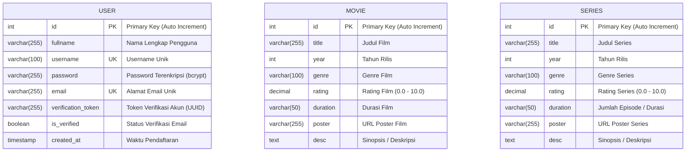

# Entity Relationship Diagram (ERD) - CHILL Movie App

Dokumen ini menjelaskan rancangan entitas dan struktur basis data untuk aplikasi **CHILL Movie & Series**, khususnya penambahan entitas **User** untuk autentikasi dan manajemen pengguna.

## 1. Visualisasi ERD



## 2. Rincian Entitas `User`

Sesuai ketentuan, entitas `User` memiliki atribut:

| Nama Atribut | Tipe Data | Constraints | Deskripsi |
|---|---|---|---|
| `id` | `INT` | `PRIMARY KEY`, `AUTO_INCREMENT` | Identifier unik pengguna |
| `fullname` | `VARCHAR(255)` | `NOT NULL` | Nama lengkap pengguna |
| `username` | `VARCHAR(100)` | `NOT NULL`, `UNIQUE` | Username untuk login / profil |
| `password` | `VARCHAR(255)` | `NOT NULL` | Hash password pengguna (dienkripsi menggunakan `bcrypt`) |
| `email` | `VARCHAR(255)` | `NOT NULL`, `UNIQUE` | Alamat email pengguna untuk login |
| `verification_token` | `VARCHAR(255)` | `NULLABLE` | Token unik untuk verifikasi email (dibuat via `uuid`) |
| `is_verified` | `BOOLEAN` | `DEFAULT FALSE` | Status verifikasi email pengguna |
| `created_at` | `TIMESTAMP` | `DEFAULT CURRENT_TIMESTAMP` | Waktu pencatatan akun |

## 3. Script SQL Pembuatan Tabel

Perintah SQL DDL untuk membuat tabel `users`:

```sql
CREATE TABLE IF NOT EXISTS `users` (
  `id` INT AUTO_INCREMENT PRIMARY KEY,
  `fullname` VARCHAR(255) NOT NULL,
  `username` VARCHAR(100) NOT NULL UNIQUE,
  `password` VARCHAR(255) NOT NULL,
  `email` VARCHAR(255) NOT NULL UNIQUE,
  `verification_token` VARCHAR(255) DEFAULT NULL,
  `is_verified` BOOLEAN DEFAULT FALSE,
  `created_at` TIMESTAMP DEFAULT CURRENT_TIMESTAMP
) ENGINE=InnoDB DEFAULT CHARSET=utf8mb4 COLLATE=utf8mb4_unicode_ci;
```
